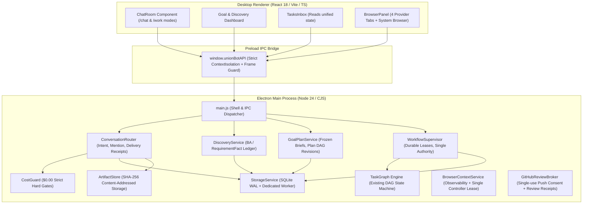
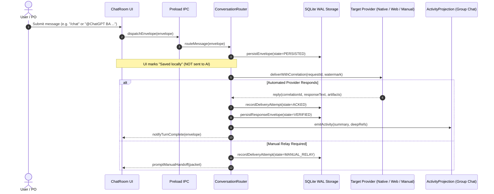

# UNION BOT V4 — ARCHITECTURE, EXECUTION FLOW & IPC AUDIT (U00-002)

## 1. System Overview & Component Boundaries

## 2. Sequence: Message Routing & Delivery Receipt Verification

## 3. IPC Channel Inventory & V4 Extension Points

1. `union-bot:dispatch-envelope`: Enhanced with `ConversationRouter` to route intent and record delivery receipts.
2. `union-bot:get-discovery-state`: New IPC for `/chat` BA facts and open questions.
3. `union-bot:update-requirement-fact`: Confirms, supersedes, or rejects facts by PO.
4. `union-bot:approve-plan-revision`: Binds plan hash, discovery digest, and single-use PO approval.
5. `union-bot:supervisor-action`: Controls pause, resume, cancel, and reconciliation.
6. `union-bot:github-request-push`: Requests single-use PO consent for review branch push.
7. `union-bot:github-receive-review`: Records incoming review verdict from ChatGPT Web.
8. `union-bot:browser-acquire-controller`: Grants single controller lease to an agent.
